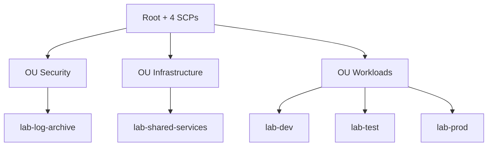

# lab-aws-docs

Landing page for an eight-repository AWS DevOps portfolio: a visitor-counter dashboard and the platform designed around it.

## Purpose

An AWS Organization, EKS, GitOps and CI/CD design written as code. The persistent `base` stack is separate
from the destroyable `cluster` and `edge` stacks to limit cost.

## What the dashboard shows

The page is served through CloudFront (`*.cloudfront.net`; there is no custom domain and no Route 53).

| Area | Content | Source |
|---|---|---|
| Counters | Total and unique visits | `lab-backend` (`GET /api/visit`), Valkey |
| History chart | Visits and unique visitors, last 30 days | Postgres `daily_stats`, written nightly by the aggregator in `lab-aws-backend` |
| Platform cards | Requests, 5xx and 4xx rate, response time, healthy targets, node CPU, cache CPU | `metrics.json` in S3, written every minute by a Lambda |

## Repositories

| Repository | Purpose | Tech |
|---|---|---|
| `lab-aws-infra-bootstrap` | Seed state bucket, GitHub OIDC provider and CI roles | CloudFormation, StackSets |
| `lab-aws-infra-organization` | Organization, OUs, accounts, SCPs, budget | Terraform |
| `lab-aws-infra-environments` | Per-environment `base`, `cluster`, `edge` stacks and their pipelines | Terraform, GitHub Actions |
| `lab-aws-gitops` | Helm charts and Argo CD app-of-apps for dev, test, prod; installs the CloudNativePG operator and defines the `lab-postgres` cluster and the aggregator CronJob | Helm, Argo CD |
| `lab-aws-backend` | Visit counting and history API, and the nightly aggregator (Valkey to Postgres) from the same image | Python 3.12, FastAPI, Valkey, Postgres |
| `lab-aws-web` | Static dashboard | HTML, CSS, ES modules, nginx |
| `lab-aws-github-workflows` | Reusable CI, release and apply workflows | GitHub Actions |
| `lab-aws-docs` | This documentation | Markdown, Mermaid |

## Accounts and OUs

Defined in `lab-aws-infra-organization`, one account per environment.

Primary region `eu-central-1`. SCP-allowed regions: `eu-central-1`, `eu-west-1`, `us-east-1`. SCPs do not apply to the management account.

## Scope

| Item | State |
|---|---|
| Terraform (org, `base`, `cluster`, `edge`), CloudFormation seed and StackSets | Complete. |
| GitHub settings (rulesets, Environments, variables) | Documented in `docs/repository-settings.md`, configured by hand. |
| Helm charts and Argo CD app-of-apps | Complete. |
| Backend, web, aggregator code | Complete, with unit and integration tests. |
| Reusable workflows (CI, release, apply) and the cost-guard workflow | Complete. |
| Placeholders to fill | `ACCOUNT_ID`, `vpc-TODO`, `sg-TODO`, repository variables |
| SonarCloud scan, post-deploy smoke test | Not written |
| Organization CloudTrail, GuardDuty, Security Hub, Config | Not implemented (SCP `lab-protect-cloudtrail` exists, but no trail) |
| Custom domain, TLS to the origin | Not built. CloudFront to ALB is plain HTTP. |
| Disaster recovery | Not built. `edge` accepts a DR ALB (`dr_alb_dns_name`); no DR cluster, replica database or failover drill exists. |

## Quick start (order of operations)

Details are in each repository README and in the runbooks.

1. `lab-aws-infra-bootstrap` stage 1: CloudFormation stack in the management account (state bucket, OIDC, org roles).
2. `lab-aws-infra-organization`: create and import the organization, then apply OUs, accounts, SCPs, budget.
3. GitHub settings: configure rulesets, Environments and variables by hand ([repository settings](docs/repository-settings.md)).
4. `lab-aws-infra-bootstrap` stage 2: StackSets for CI roles in workload accounts and the platform state bucket.
5. Fill placeholders and set repository variables in `lab-aws-infra-environments` (`DEV_ACCOUNT_ID`, `PLATFORM_STATE_BUCKET`, ...).
6. `lab-aws-infra-environments`: apply `base`, then `cluster` (workflow `apply.yml` or locally; the stack is AWS-only).
7. Run `scripts/bootstrap-argocd.sh <env> <owner>` once per cluster. Wait for Argo CD to sync `lab-aws-gitops` and for the ALB `lab-<env>-alb` to exist.
8. `lab-aws-infra-environments`: apply `edge`. Open the CloudFront URL.
9. Teardown, locally: `scripts/destroy.sh <env> <region>` destroys `edge`, runs `teardown.sh`, then destroys `cluster`. `base` stays. The `cost-guard` workflow reports environments still running.

## Cost

Budget about 100 USD per month, alerts at 50, 80 and 100 percent. The `cost-guard` workflow runs every 6 hours and fails when a cluster or NAT gateway is running. Estimated about 0.40 USD per hour per running environment
(EKS control plane 0.10, 2x t3.large, NAT, ALB, cache). This is an estimate.

## Documents

`docs/architecture.md` (architecture and diagrams), `docs/cost.md` (estimate and controls), `docs/security.md` (controls and gaps), `docs/repository-settings.md` (GitHub settings), `docs/adr/` (decision records), `docs/runbooks/` (operations).
