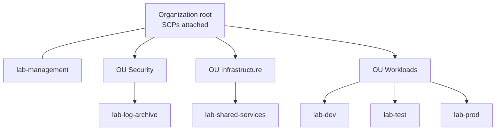
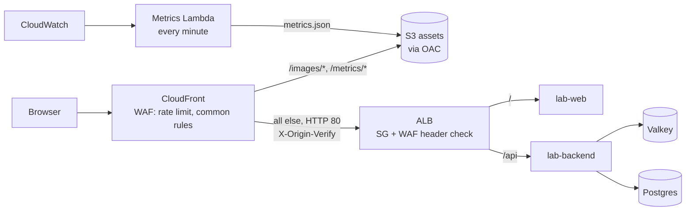
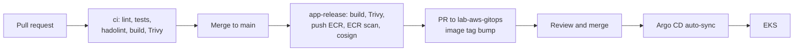
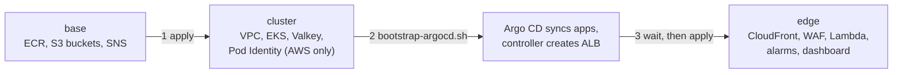
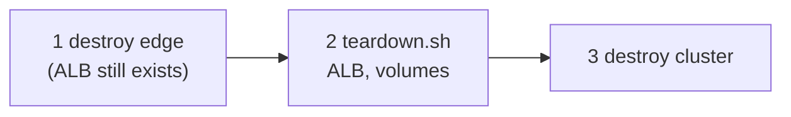
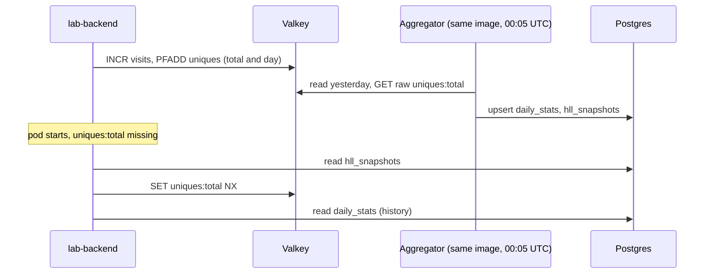

# Architecture

## 1. Accounts and OUs

`lab-aws-infra-bootstrap` seeds the management account (state bucket, OIDC, CI roles) and, through StackSets, the member accounts. `lab-aws-infra-organization` creates the OUs, accounts, SCPs and budget. `lab-shared-services` holds the platform Terraform state bucket.

- SCPs on the root: no leaving the organization, no actions outside eu-central-1, eu-west-1 and us-east-1 (global services excepted), no root user in member accounts, no stopping CloudTrail. SCPs do not apply to the management account.
- Each environment has its own account. Accounts have `prevent_destroy`.
- State isolation: the shared bucket policy lets an account use only its own `envs/<env>/` prefix.
- CI uses GitHub OIDC roles, no stored AWS keys. The apply role in a workload account has AdministratorAccess behind a GitHub Environment (in the documented settings, `test` and `prod` require a reviewer, `dev` does not; see [repository settings](repository-settings.md)).
- Budget: 100 USD per month, alerts at 50, 80 and 100 percent of actual spend.
- Gap: no resources are defined for `lab-log-archive`. Organization CloudTrail, GuardDuty, Security Hub and Config are not implemented.

## 2. Request flow

The browser loads the page from `lab-web` (nginx), then calls `GET /api/visit`. The dashboard reads platform cards from `/metrics/metrics.json`, so the browser never calls AWS APIs. Both apps share one ALB through an Ingress group; `/api` is evaluated before `/`.

- Access is through the `*.cloudfront.net` URL. There is no custom domain and no Route 53.
- CloudFront to ALB is plain HTTP, because there is no origin name with a certificate. Viewers always use HTTPS.
- Origin lock-down: the ALB security group admits only the CloudFront origin-facing prefix list. A regional WAF blocks requests without the secret `X-Origin-Verify` header.
- `/images/*` is cached with the managed optimized policy. `/metrics/*` is cached 30 s. Everything else is uncached.
- The namespace is default-deny with explicit allow rules. Pods run with a read-only root filesystem.
- Valkey and Postgres sit behind the backend only. Valkey uses TLS in transit, at rest encryption and an AUTH token delivered by External Secrets from SSM.
- DR gap: the edge module accepts `dr_alb_dns_name` and then builds a CloudFront origin group (5xx failover, GET/HEAD/OPTIONS only). No environment sets it. No DR cluster, replica database or failover drill exists.

## 3. CI/CD flow

Reusable workflows live in `lab-aws-github-workflows` and are called by `lab-aws-backend` and `lab-aws-web`. Each environment rebuilds the same commit in its own account and ECR.

| Trigger | Target |
|---|---|
| push to `main` | dev |
| tag `vX.Y.Z` | test |
| manual dispatch with a tag | prod |

- No path writes to a cluster or to `main` directly. The bot only opens a PR that changes the one `tag:` line in `envs/<env>/values/`.
- Gates: Trivy fails on CRITICAL before push. The ECR scan is checked after push. Branch rulesets (documented in [repository settings](repository-settings.md)) require a PR, one approval and status checks.
- ECR tags are immutable. Images are signed with keyless cosign. Nothing in the cluster verifies signatures.
- Not written: SonarCloud scan and the post-deploy smoke test. Placeholders remain: `ACCOUNT_ID`, `sg-TODO`, `vpc-TODO` and the repository variables.

## 4. Terraform stacks and order

Destroy runs locally in the reverse order, with the in-cluster cleanup between the two stacks:

Each of `dev`, `test` and `prod` has the three stacks in `lab-aws-infra-environments/envs/<env>/<stack>`, using shared modules. `apply.yml` applies `base`, `cluster` or `edge`; the `cluster` stack is AWS-only and needs no Kubernetes API access. Destroy is local only: `scripts/destroy.sh <env> <region>` destroys `edge` first, runs `scripts/teardown.sh` (Argo CD scaled down, Ingresses, CNPG clusters and PVCs removed, leftover volumes found by the volume tag `lab-cluster=lab-<env>`) and then destroys `cluster`. The `cost-guard` workflow in `lab-aws-infra-environments` runs every 6 hours and fails when an environment still has a cluster or NAT gateway.

- `base` is never destroyed: images, backups, assets and alert topics outlive the cluster.
- Terraform owns the AWS side only. `scripts/bootstrap-argocd.sh <env> <owner>` installs Argo CD and the root app-of-apps once per cluster; after that Argo CD syncs everything inside the cluster from `lab-aws-gitops`. Argo CD itself is upgraded by rerunning the script.
- `edge` reads the ALB, bucket and SNS topics with data sources, so it must be applied after the ALB exists and destroyed before the ALB goes, that is, first.
- Start-up ordering between Argo CD Applications relies on a health check for `Application` plus retries (10 attempts, about 20 minutes).
- Environments differ: dev and test use Spot nodes and 2 AZs; prod uses On-Demand nodes, 3 AZs, 2 replicas per app and 2 Postgres instances.
- Valkey is one `cache.t4g.micro` node, no replica, no snapshots.
- Assumptions: target groups are found through the `lab-service` tag set by the Service annotations; the Lambda reads the cache node `lab-<env>-valkey-001`.

## 5. Visit data flow

Each `GET /api/visit` identifies the visitor by cookie `lab_vid` and updates counters in one pipeline. Valkey holds live counters, Postgres holds history. The nightly aggregator is a CronJob that runs from the `lab-backend` image (`python -m aggregator.job`).

- Unique counts use HyperLogLog (about 1 percent error). Daily keys expire after 3 days.
- The aggregator is idempotent. `AGGREGATE_DAY=YYYY-MM-DD` redoes a day. The first history row appears after the first full day.
- Only `uniques:total` is snapshotted. After a cache loss `visits:total` restarts at zero, and unique visitors lose at most the time since the last snapshot (one day).
- Restore runs only at backend start. If Valkey is lost while pods keep running, new visits recreate `uniques:total` and the next nightly run snapshots that partial value over the good one.
- Degradation: Postgres down gives empty history. Valkey down gives HTTP 503 with `counters_available: false` plus history. `/api/health` depends on neither.
- Postgres (CloudNativePG) backs up to S3 daily at 02:00 UTC with continuous WAL, retention 7 days. The in-tree Barman integration is deprecated and must be migrated before CNPG 1.31.
